# Scan-chan はじめての使い方

## まずは動画で見る

**まずは、バーコードを続けて読む様子をご覧ください（約16秒・早送りなし）。**

動画の **▶** を押すと再生します。

https://github.com/user-attachments/assets/628b961a-97c2-4a8e-bbe8-1a76d14ec7fc

動画は以前の版で撮影した読み取り例です。番号は撮影用で、現在の画面とは一部異なります。

## この手順の進め方

**画面の写真を見ながら、上から順番に進めてください。**

スマートフォンや業務用端末だけで、バーコードを読めるようにできます。パソコンは使いません。

Ytrackは、いつもどおり使える状態にしておいてください。

> この手順は **Scan-chan 0.8.8** 用です。Android 10以上の端末で使えます。写真と少し見た目が違っても、同じ名前のボタンを探してください。

### はじめて設定する方

この下の **「準備：Scan-chanを端末に入れる」** から、順番に進めてください。

### すでに設定が終わっている方

- [いま使っているScan-chanを更新する](#いま使っているscan-chanを更新する)
- [いつもの使い方](#いつもの使い方)
- [持ち帰り・その他業務で1件ずつ読む](#持ち帰りその他業務で1件ずつ読む)
- [文字を打つキーボードに戻したい](#文字を打つキーボードに戻したい)
- [音を変えたい](#音を変えたい)
- [困ったとき](#困ったとき)

## いま使っているScan-chanを更新する

> [!IMPORTANT]
> **いま入っているScan-chanを、先に削除しないでください。**
>
> 「更新」で入れ替えると、これまでの設定を引き継げます。今回の更新のために、パソコンへつなぐ必要はありません。

1. Scan-chanを開き、**「使い方を見る」** を押します。
2. **「アプリの更新」→「更新ページを開く」** を押します。
3. **Scan-chan.apk** をダウンロードし、終わったら **「開く」** を押します。
4. 確認画面で **「更新」** を押します。
5. 更新が終わったら、一度Scan-chanを開きます。**「使い方を見る」→「アプリ情報」** に **0.8.8** と出れば更新できています。

0.8.8では、持ち帰り・その他業務でもバーコードを1件ずつ読めます。**この機能を使うには、更新後に次の設定を1回行ってください。** いろいろな入力欄で数字キーも使えます。

### 更新後、持ち帰り・その他業務を使う準備

1. Scan-chanを開き、設定一覧の **「持ち帰り・その他業務の読み取り」** を押します。
2. **「端末の設定を開く」** を押します。
3. 端末の一覧で **「Scan-chan 持ち帰り・その他業務の読み取り」** を選び、スイッチをONにします。確認が出たら名前を確かめて **「許可」** または **「OK」** を押します。
4. 端末の **「戻る」** でScan-chanへ戻り、**「準備できています」** と表示されたら完了です。設定一覧では **「使えます」** と表示されます。

この設定は端末だけでできます。Ytrackの「その他業務」では保管中以外の理由でも使えます。持出・配完・貨物問い合わせを使わない場合、それぞれの設定をONにする必要はありません。

> [!TIP]
> 端末に **「制限付き設定」** と出てONにできないときは、[こちらの手順](#困ったとき)を先に行ってください。ONにしても接続待ちのままの場合は、[困ったとき](#困ったとき)を確認してください。

ダウンロードしたファイルが見つからないときは、端末の **「ファイル」** または **「Files」→「ダウンロード」** を開いてください。

更新後も、ふだんのキーボード・音・自動切替の設定を使えます。設定が「接続待ち」になっていたら、Scan-chanを一度閉じて開き直してください。直らないときは、[困ったとき](#困ったとき)へ進みます。

## 準備：Scan-chanを端末に入れる

### ファイルを受け取る

**Scan-chanを使う端末で、次のリンクを押します。**

**[ここを押してScan-chanをダウンロード](https://github.com/totkd/Scan-chan-releases/releases/download/v0.8.8/Scan-chan.apk)**

確認が出たら、名前が **Scan-chan.apk** であることを確認して、ダウンロードを進めます。

ダウンロードが終わったら、**「開く」** を押してください。見つからない場合は、端末の **「ファイル」** または **「Files」** を開き、**「ダウンロード」** の中にある **Scan-chan.apk** を押します。

「この提供元のアプリを許可」などが出た場合は、次の順で進めます。

1. **「設定」** を押します。
2. **「この提供元のアプリを許可」** をONにします。
3. **「戻る」** で、ひとつ前の画面に戻ります。

### 「インストール」を押す

名前が **Scan-chan** になっていることを確認して、**「インストール」** を押します。

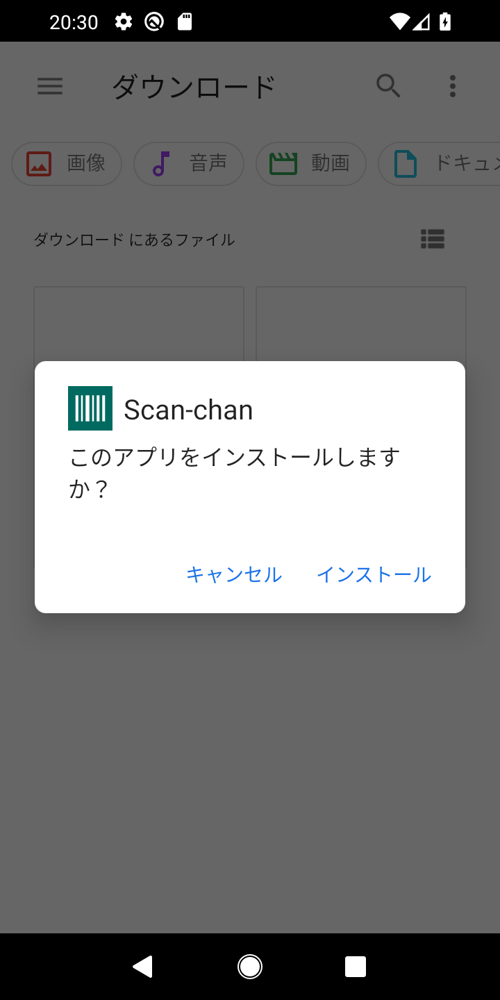

すでにScan-chanが入っている場合は、**「更新」** と出ることがあります。そのまま更新してください。**先にアプリを削除する必要はありません。**

<strong>「アプリのスキャンをおすすめします」と出た場合</strong>

Google Play プロテクトの確認です。**「アプリをスキャン」** を押してください。

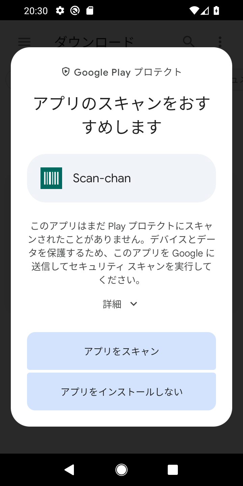

確認が終わったら、画面の **「インストール」** を押して進めます。進められない場合は、その画面を担当者へ見せてください。

### 「開く」を押す

「アプリをインストールしました」と出たら、**「開く」** を押します。

閉じてしまった場合は、端末のアプリ一覧から **Scan-chan** を開いてください。

最初から設定一覧が出た場合、設定を見直すときは、画面下の **「使い方を見る」→「最初の準備」** を押してください。

## はじめの設定

ここからは、Scan-chanの案内に沿って、ひとつずつ設定します。

> [!TIP]
> **別の設定画面に変わっても大丈夫です。**
>
> 設定が終わったら、端末の **「戻る」** でScan-chanへ戻ります。写真の端末では、画面下の **◀** が「戻る」です。ボタンのない端末は、画面の左端か右端から内側へ指でなぞります。
>
> **「設定できています」** と出たら、**「次へ」** を押してください。すでに設定できている項目は、そのまま次へ進めます。

### 1. カメラを使えるようにする

#### 「カメラを許可する」を押す

バーコードを読むために、カメラを使えるようにします。

**「カメラを許可する」** を押します。

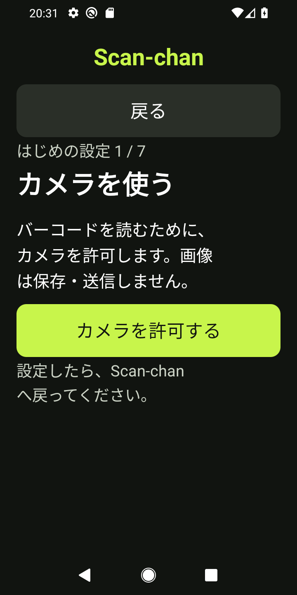

#### 「許可」を押す

**「許可」** を押します。端末によって **「アプリの使用中のみ」** と出た場合は、それを選びます。

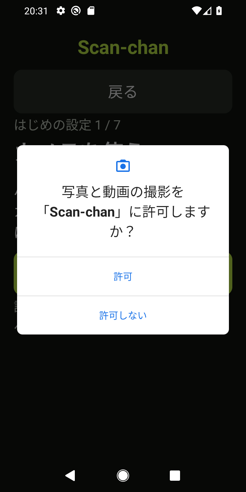

**「設定できています」** と出たら、**「次へ」** を押してください。

### 2. Scan-chanのキーボードを使えるようにする

#### 「キーボード一覧を開く」を押す

**「キーボード一覧を開く」** を押します。

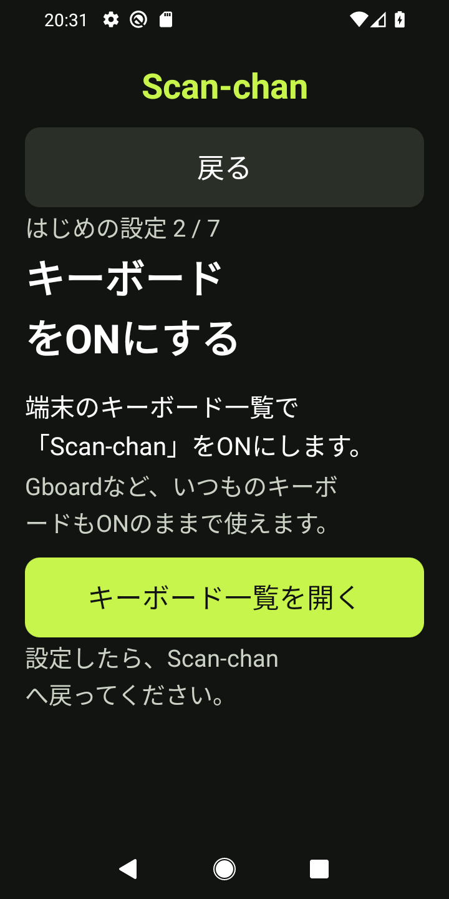

#### Scan-chanをONにする

**Scan-chanの横のスイッチ** を押して、ONにします。

**いつも使っているキーボードは、ONのままにしてください。** GboardなどをOFFにする必要はありません。

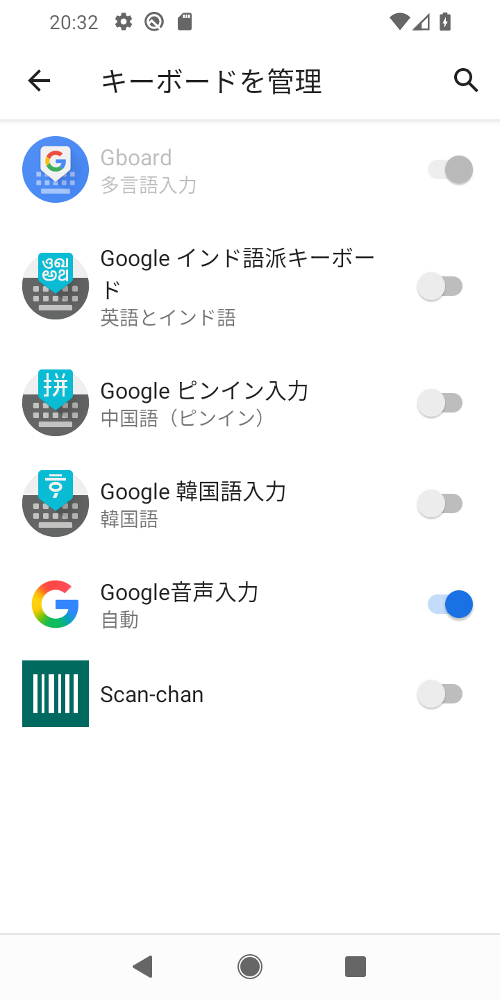

#### 確認が出たら「OK」を押す

新しいキーボードを使うときの確認です。**Scan-chanについての確認であることを確かめて、「OK」** を押します。

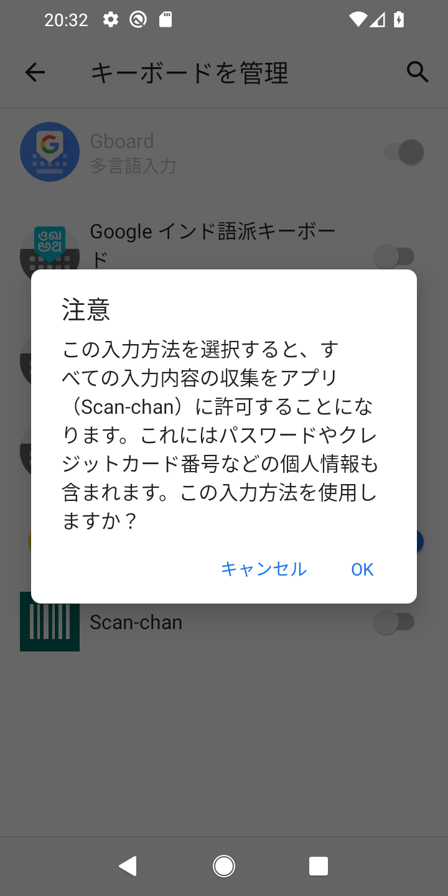

再起動したあとのロック解除についての確認が続けて出たら、**「OK」** を押します。

端末の **「戻る」** でScan-chanへ戻ります。**「設定できています」→「次へ」** の順に進んでください。

### 3. 今使うキーボードをScan-chanにする

#### 「Scan-chanを選ぶ」を押す

**「Scan-chanを選ぶ」** を押します。

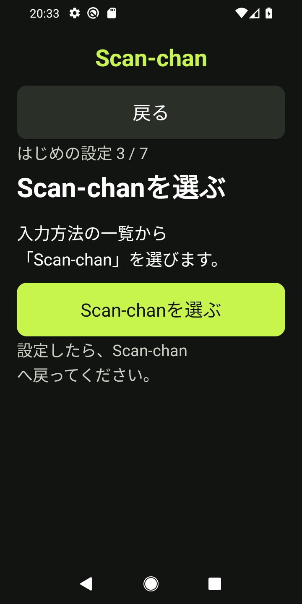

#### 一覧の「Scan-chan」を押す

表示された一覧から、**「Scan-chan」** を押します。

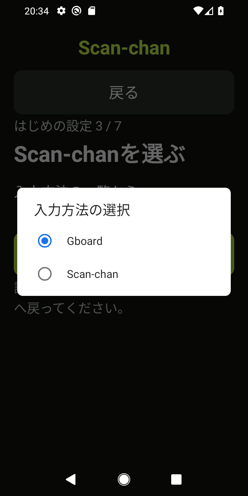

**「設定できています」** と出たら、**「次へ」** を押してください。

### 4. 貨物問い合わせで使えるようにする

ここからは、問い合わせ・持出・配完・持ち帰り／その他業務を、順番に設定します。

**設定をONにするだけでは、荷物の読み取りや登録は始まりません。**

#### 「ユーザー補助を開く」を押す

**「ユーザー補助を開く」** を押します。「ユーザー補助」は、端末の設定画面の名前です。

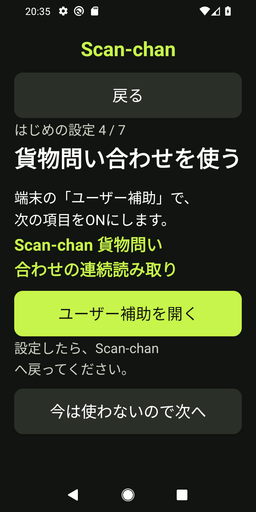

#### 「Scan-chan 貨物問い合わせの連続読み取り」を押す

似た名前が並んでいます。まずは、**「貨物問い合わせ」** が入った名前を押します。

一覧が見当たらない端末では、**「インストール済みアプリ」** や **「ダウンロードしたアプリ」** などを開いて探してください。

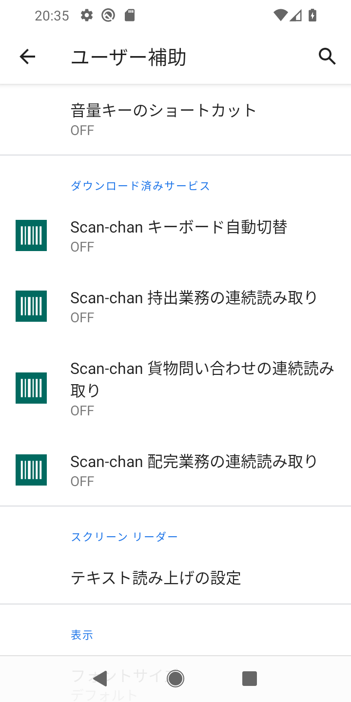

#### スイッチをONにする

**画面上のスイッチを押して、ON** にします。

写真では、**「サービスの使用」** と書かれた行の右側です。

「ショートカット」も表示される端末では、そちらではなく、**この機能を使うためのスイッチ** をONにしてください。

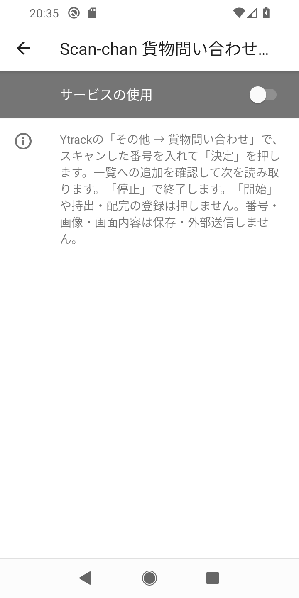

#### 確認画面で「許可」を押す

Scan-chanが番号を入れて、ボタンを押せるようにする確認です。

名前が **「Scan-chan 貨物問い合わせの連続読み取り」** であることを確かめて、**「許可」** を押します。端末によって **「OK」** と出る場合もあります。

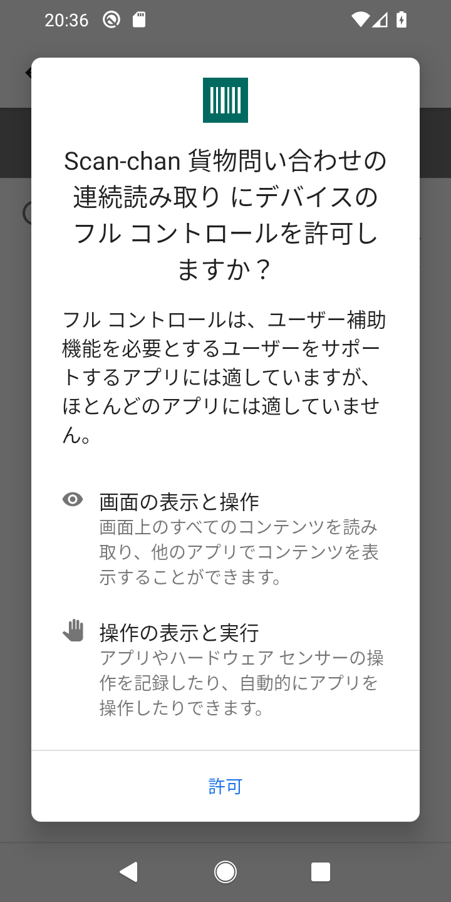

#### Scan-chanへ戻り、「次へ」を押す

端末の **「戻る」** を押して、Scan-chanの黒い画面へ戻ります。ひとつ前の画面に戻るだけの場合は、もう一度押してください。

**「設定できています」** と出たら、**「次へ」** を押します。

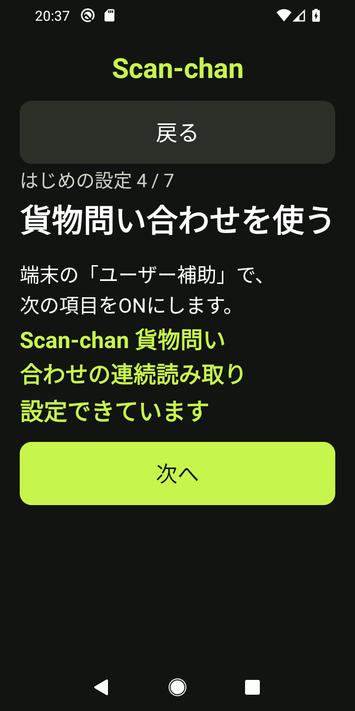

「ONです。接続を待っています。」から変わらない場合は、[困ったとき](#困ったとき)を見てください。

### 5. 持出で使えるようにする

#### 「ユーザー補助を開く」を押す

**「ユーザー補助を開く」** を押します。

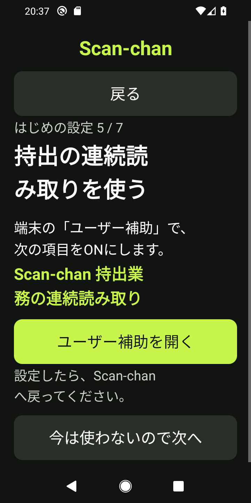

#### 「Scan-chan 持出業務の連続読み取り」をONにする

今度は、一覧から **「Scan-chan 持出業務の連続読み取り」** を押します。

**スイッチをON** にします。

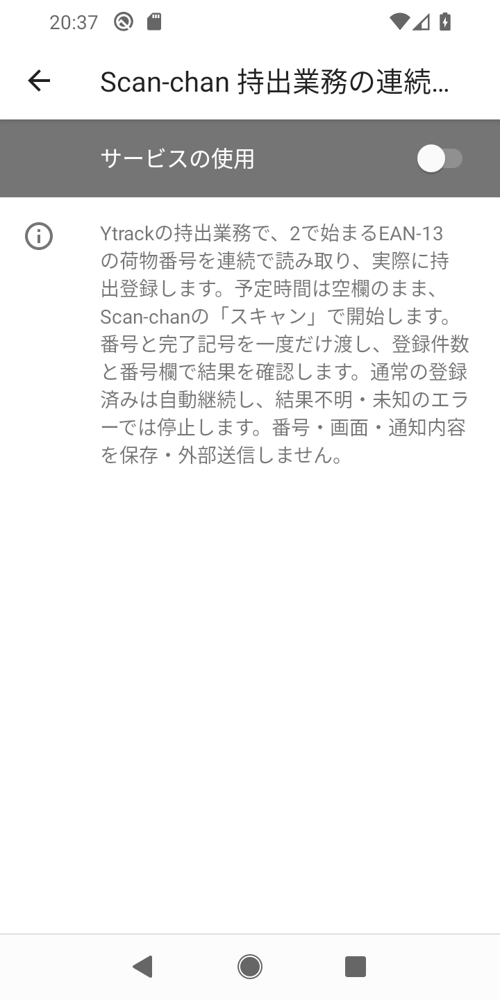

確認が出たら、名前に **「持出業務」** があることを確かめて、**「許可」** または **「OK」** を押します。

端末の **「戻る」** でScan-chanへ戻ります。**「設定できています」→「次へ」** の順に進んでください。

### 6. 配完で使えるようにする

#### 「ユーザー補助を開く」を押す

**「ユーザー補助を開く」** を押します。

#### 「Scan-chan 配完業務の連続読み取り」をONにする

一覧から **「Scan-chan 配完業務の連続読み取り」** を押します。

**スイッチをON** にします。

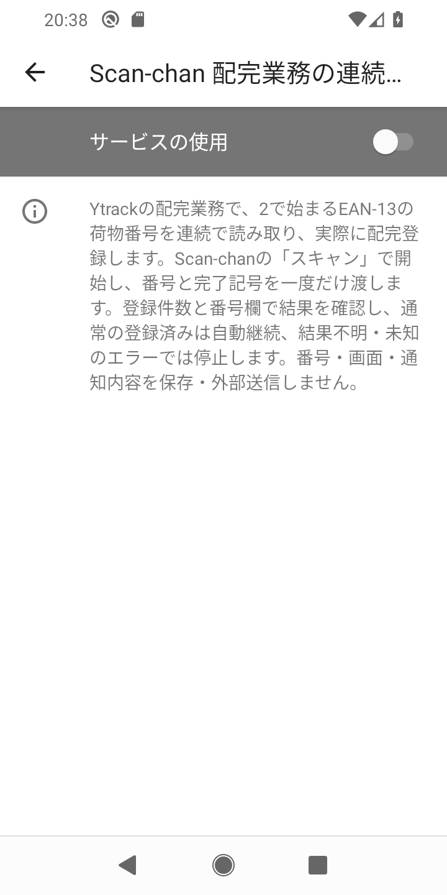

確認が出たら、名前に **「配完業務」** があることを確かめて、**「許可」** または **「OK」** を押します。

端末の **「戻る」** でScan-chanへ戻ります。**「設定できています」→「次へ」** の順に進んでください。

### 7. 持ち帰り・その他業務で使えるようにする

その他業務では保管中以外の理由でも使えます。この項目の画面写真はまだありません。表示された名前を見ながら進めてください。

1. **「ユーザー補助を開く」** を押します。
2. 端末の一覧から **「Scan-chan 持ち帰り・その他業務の読み取り」** を選びます。
3. スイッチをONにし、確認画面で名前を確かめて **「許可」** または **「OK」** を押します。
4. 端末の **「戻る」** でScan-chanへ戻り、**「設定できています」→「次へ」** の順に進みます。

持ち帰り・その他業務を今は使わない場合は、**「今は使わないので次へ」** を押せます。あとから設定一覧で変更できます。

**「制限付き設定」** と出た場合は、[こちらの手順](#困ったとき)を先に行ってください。ONにしても **「接続を待っています」** と出る場合は、[困ったとき](#困ったとき)を確認してください。

### 8. 「今は手動で使う」を選ぶ

#### 「今は手動で使う」を押す

**「今は手動で使う」** を押してください。先に設定した業務では、Scan-chanを手動で選んでバーコードを読めます。

「初回のみPC/Macでの設定が必要です」と出ていても、ここではパソコンは必要ありません。

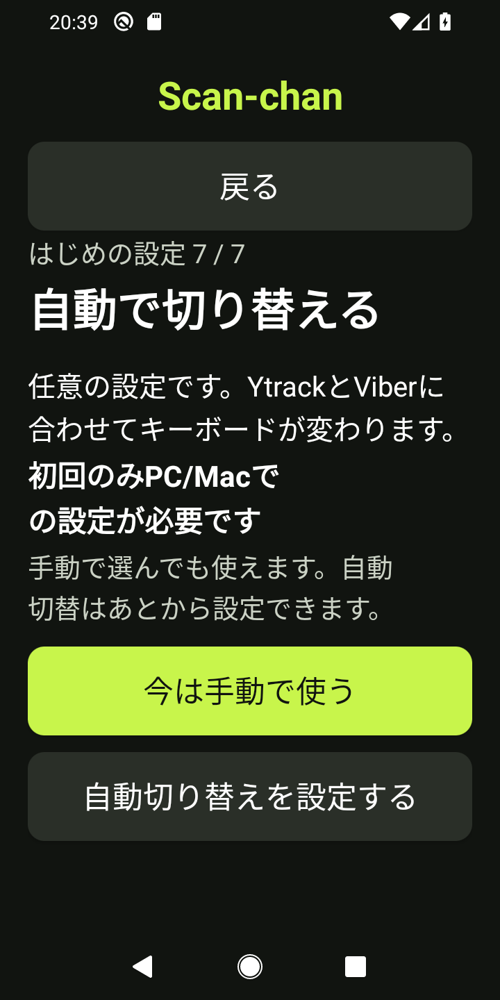

写真は以前の版です。0.8.8では、この画面は **8番目** です。

自動切り替えは、あとから設定できます。使いたい方は、[自動でキーボードを切り替えたい](#自動でキーボードを切り替えたい)を見てください。

### 設定完了：「準備ができました」

#### 「設定一覧を開く」を押す

**「準備ができました」** と出たら、**「設定一覧を開く」** を押します。

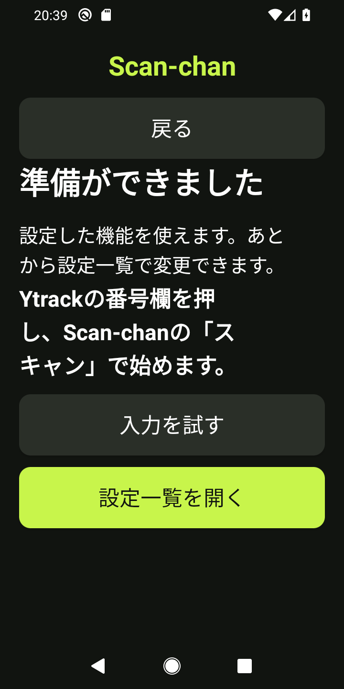

**これで、はじめの設定は終わりです。**

次からScan-chanを開くと、この設定一覧が出ます。音や数字の並びは、あとからここで変えられます。

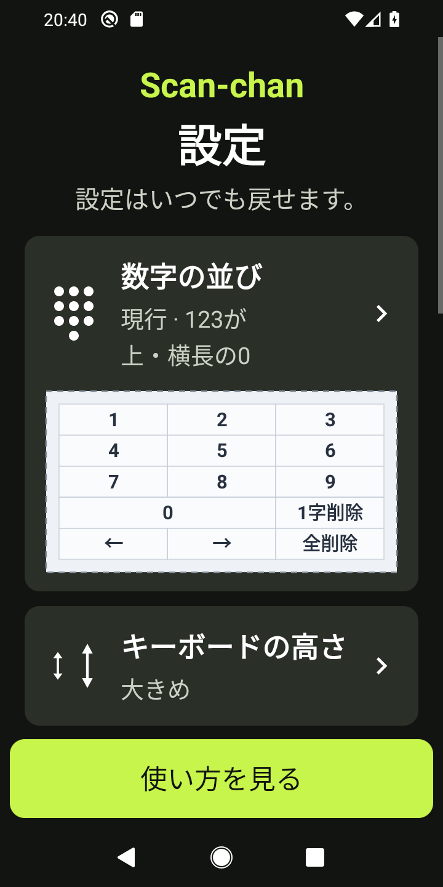

途中で **「今は使わないので次へ」** を押した業務は、まだ設定が済んでいません。その業務を使う前に、設定一覧から該当する項目を開いて設定してください。

## いつもの使い方

> [!WARNING]
> **持出・配完では、読み取ると実際に登録されます。**
>
> 練習のつもりで、業務中の荷物を読み取らないようにしてください。

### Ytrackで使いたい業務を開く

- **持出**：**「センター業務」→「持出業務」**。配達予定時間と送り状番号は、空欄にしておきます。
- **配完**：**「軒先業務」→「配完業務」**。番号は空欄にしておきます。
- **貨物問い合わせ**：**「その他」→「貨物問い合わせ」**。番号は空欄にしておきます。

### 持出・配完・貨物問い合わせを続けて読む

1. Ytrackの **番号を入れる欄** を押します。
2. Scan-chanのキーボードを表示します。違うキーボードが出た場合は、[キーボードを選び直します](#文字を打つキーボードに戻したい)。
3. スキャンボタンに、使いたい業務名と **「連続読み取り」** が出ていることを確認します。
4. **「スキャン」** を押します。
5. バーコードの真ん中を、画面中央の十字に合わせます。
6. 完了の音と青い表示、または「登録済み」の案内を確認して、次のバーコードへ移します。
7. 終わったら **「停止」** を押します。

通常の **「登録済み」** は、自動で閉じて次へ進みます。それ以外のエラーなどで止まったときは、Ytrackの表示を確認してから再開してください。

持出では、Scan-chanを選ぶと **送り状番号の欄** に自動で移ります。配達予定時間は空欄のままにしてください。

### キーボードを隠して、入力済みの一覧を見たい

端末の **「戻る」** を1回押します。読み取りが止まり、Scan-chanのキーボードが隠れます。Ytrackの画面はそのままなので、一覧を確認できます。

また入力したいときは、**番号を入れる欄** を押してください。キーボードだけが戻ります。続けて読み取るときは、もう一度 **「スキャン」** を押します。

> [!TIP]
> **一覧を見ている間は、キーボードは勝手に出てきません。**
> 「停止」はカメラを閉じるボタン、「戻る」はキーボードごと隠す操作です。

### 貨物問い合わせの最後にすること

**貨物問い合わせは9件で止まります。最後にYtrackの「開始」を押してください。**

### 持ち帰り・その他業務で1件ずつ読む

持ち帰り・その他業務では、**バーコードを1件読むと番号が入り、カメラが閉じます。** 数字キーでも入力できます。

初めて使うときは、先に[持ち帰り・その他業務を使う準備](#更新後持ち帰りその他業務を使う準備)をしてください。

#### Ytrackの画面を開く

- **持ち帰り**：Ytrackの **「持帰業務」** を開きます。
- **その他業務**：Ytrackの **「その他業務」** を開きます。**「その他理由」** は、保管中など、どの理由でも使えます。

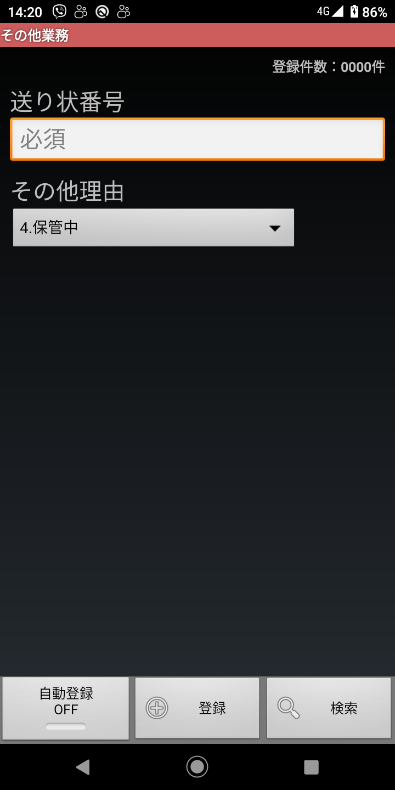

写真は **「4.保管中」** を選んだ例です。ほかの理由でも使えます。

#### 空の番号欄を押し、「スキャン」を押す

1. Ytrackの **「自動登録」がOFF** になっていることを確認します。
2. 空の番号欄を押し、Scan-chanを表示します。
3. ボタンの案内が **「1件ずつ読み取り・番号を入れます」** であることを確認し、**「スキャン」** を押します。
4. バーコードの真ん中を、画面中央の十字に合わせます。
5. 番号が入り、カメラが閉じます。Ytrackの内容を確認して、必要な操作はYtrackで行います。

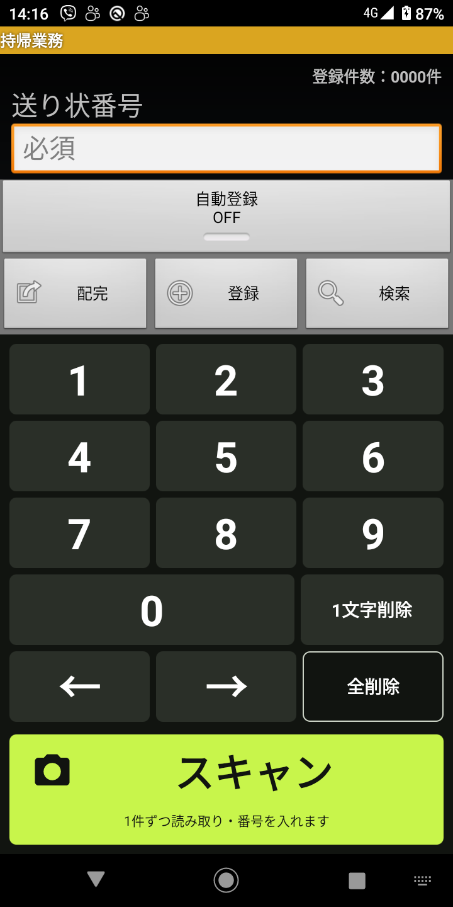

次の荷物を読むときは、番号欄が空になっていることを確かめて、もう一度 **「スキャン」** を押してください。

### ほかの画面でも数字を入力する

Scan-chanを選ぶと、ほかの入力欄でも数字キーを使えます。スキャンボタンは、持出・配完・貨物問い合わせ・持ち帰り・その他業務の番号欄に表示されます。

## 文字を打つキーボードに戻したい

Viberなどで文字を打つときは、いつものキーボードを選びます。

### 小さいキーボードのマークを押す

文字を入れる欄を押してキーボードを出します。

**画面のいちばん下にある、小さいキーボードのマーク** を押します。写真の例では、右下にあります。

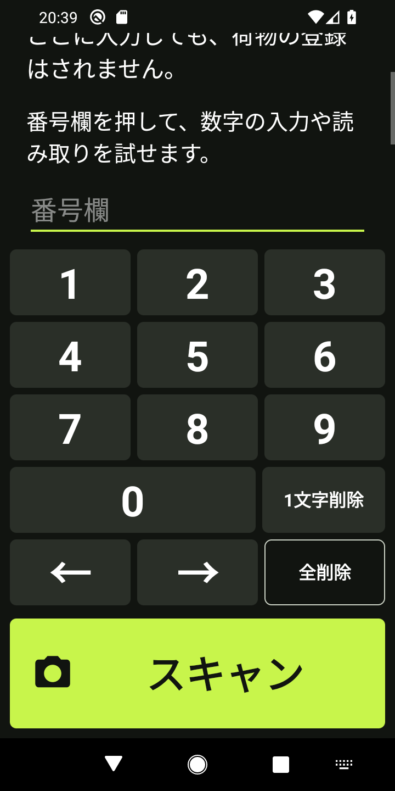

写真は以前の版の練習画面です。0.8.8の練習画面にはスキャンボタンは表示されません。YtrackやViberでも、キーボードが出ているときに同じマークを探してください。

マークが見当たらない場合は、画面のいちばん上から下へ指でなぞり、通知の **「入力方法を選択」** などを押します。場所や名前は端末によって違います。

### 使いたいキーボードを選ぶ

**文字を打つときは、いつものキーボード** を選びます。写真の例では **Gboard** です。

**バーコードを読むときは「Scan-chan」** を選びます。

## 音を変えたい

### 「読み取り音」または「エラー音」を押す

Scan-chanの設定一覧を開きます。見当たらないときは、画面を下から上へ指でなぞると、下にある項目が見えます。

**「読み取り音」** または **「エラー音」** を押します。

### 好きな音の名前を押す

音の名前を押すと、試しに鳴ります。**選んだ音が、そのまま保存されます。保存ボタンを押す必要はありません。**

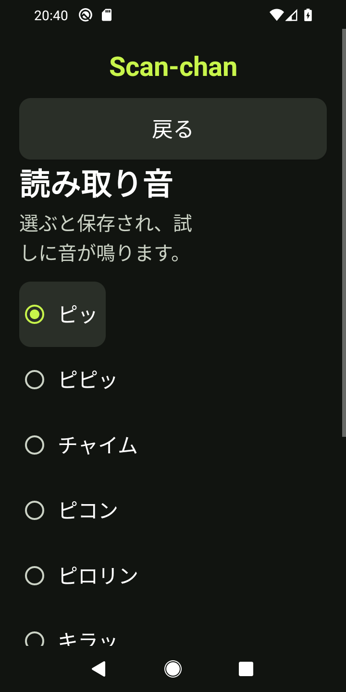

決まったら **「戻る」** で設定一覧へ戻ってください。

## 自動でキーボードを切り替えたい

この設定をすると、YtrackではScan-chan、Viberではいつものキーボードに、自動で変わります。

**使わなくても、手動で選んでバーコードを読めます。**

1. Scan-chanの設定一覧で **「キーボード自動切り替え」** をONにします。
2. 出てきた案内を確認します。

### 「初回のみPC/Macでの設定が必要です」と出た場合

その画面を担当者へ見せてください。自動切り替えを使うための最初の設定だけ、担当者に依頼します。設定を待つ間も、手動で使えます。

### 「この端末だけで設定できます」または「PC/Macでの初回設定は済んでいます」と出た場合

1. **「端末の設定を開く」** を押します。
2. **「Scan-chan キーボード自動切替」** を選び、ONにします。
3. 確認が出たら、名前を確かめて **「許可」** または **「OK」** を押します。
4. Scan-chanへ戻り、**「自動切り替えを使えます」** と出れば完了です。

## 困ったとき

### 「ONです。接続を待っています。」のまま変わらない

1. もう一度 **「ユーザー補助を開く」** を押します。
2. いま設定しているScan-chanの項目を、一度OFFにします。
3. 同じ項目を、もう一度ONにします。
4. Scan-chanへ戻って確認します。

設定一覧で **「ONですが、未接続です」** と出ている場合は、その業務を押し、次のボタンから設定を開きます。

- 貨物問い合わせ：**「端末の設定を開く」**
- 持出：**「持出連携の設定を開く」**
- 配完：**「配完連携の設定を開く」**
- 持ち帰り・保管中：**「端末の設定を開く」**

そのあと、同じ項目を一度OFFにして、もう一度ONにし、Scan-chanへ戻って確認します。

それでも変わらない場合は、**端末の電源を入れ直します。ロックを解除してから、Scan-chanを開いてください。**

### 「制限付き設定」と出て、ONにできない

新しいAndroidでは、この確認が出ることがあります。以下を押すと、手順が開きます。

<strong>「制限付き設定」が出たときの手順を見る</strong>

担当者から案内されたScan-chanを入れていることを確認して、次へ進んでください。

1. 端末の **「設定」** を開きます。
2. **「アプリ」** を押します。
3. **「Scan-chan」** を押します。見当たらない場合は **「すべてのアプリ」** を開いて探します。
4. 右上の **「︙」** を押します。
5. **「制限付き設定を許可」** を押します。
6. 端末から求められたら、いつもの画面ロック解除の操作をします。
7. Scan-chanへ戻り、もう一度 **「ユーザー補助を開く」** から、設定したい項目をONにします。

端末によって、この項目が出ないこともあります。見当たらない、または進められない場合は、止まった画面を担当者へ見せてください。

[Googleの説明を見る](https://support.google.com/android/answer/12623953?hl=ja)

### 「管理者により無効」などと出る

会社側で設定が制限されている場合があります。**その画面を担当者へ見せてください。**

### Scan-chanがキーボードの一覧に出ない

[2. Scan-chanのキーボードを使えるようにする](#2-scan-chanのキーボードを使えるようにする)に戻り、Scan-chanがONになっているか確認してください。そのあと、もう一度キーボードを選びます。

### 持出・配完でスキャンボタンが出ない

まず、Ytrackの持出または配完の番号欄を押してください。それでも出ない場合は、Scan-chanの設定で使う業務を開き、**「使えます」** と表示されるか確認します。使えない場合は、表示される案内に沿って端末の設定を確認してください。

### 持ち帰り・その他業務でスキャンボタンが出ない

Scan-chanの設定一覧で **「持ち帰り・その他業務の読み取り」** を押し、**「準備できています」** と出ているか確認してください。設定がまだの場合は、[使う準備](#更新後持ち帰りその他業務を使う準備)を行います。Ytrackの持ち帰り・その他業務を開き、番号欄を押してください。

### カメラが出ない

端末の **「設定」→「アプリ」→「Scan-chan」→「権限」→「カメラ」** を開き、カメラを許可してください。

### もう一度、最初から設定を見直したい

Scan-chanの画面下にある **「使い方を見る」→「最初の準備」** を押します。

すでに設定できている項目は **「次へ」** で進められます。設定を見直すために、アプリを削除する必要はありません。

### まず練習してみたい

はじめの設定の最後、**「準備ができました」** の画面で **「入力を試す」** を押します。

この練習画面では、数字キーで番号を入れられます。**荷物は登録されません。** スキャンボタンは表示されません。終わったら **「設定へ戻る」** を押してください。

### アプリを入れられない・削除するように言われた

**いったん止めて、その画面を担当者へ見せてください。** 自分で削除してやり直す必要はありません。

---

初期設定の写真はScan-chan 0.8.3を、パソコン上に再現したAndroid 10で動かして撮影しています。0.8.8で追加した持ち帰り・その他業務の設定画面の写真はまだありません。自動切り替えの画面は、写真では7番目ですが0.8.8では8番目です。持ち帰り・保管中のYtrack画面の写真は、業務用端末のAndroid 10で撮影しました。端末によって、色・ボタンの位置・言葉が少し違う場合があります。

担当者向けの詳しい設定・確認事項は、[担当者向け手順書](INSTALL_ADMIN.md)にまとめています。
